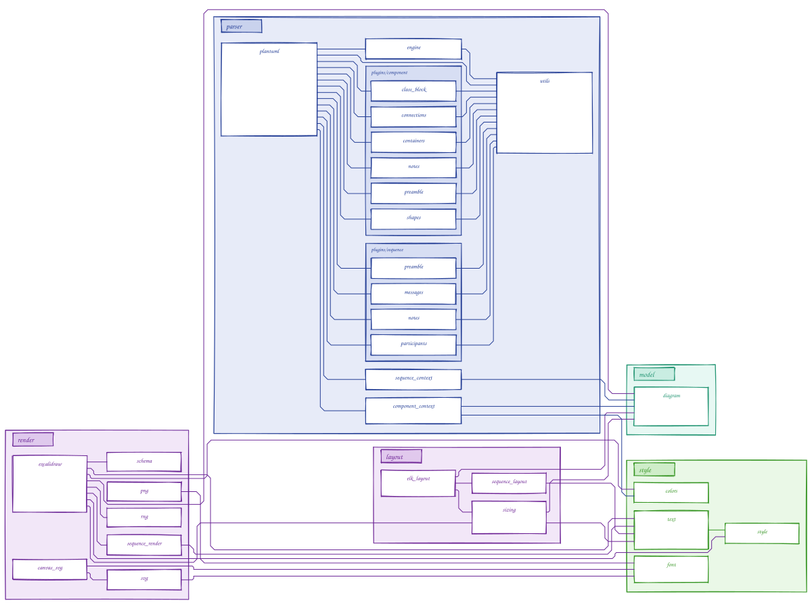
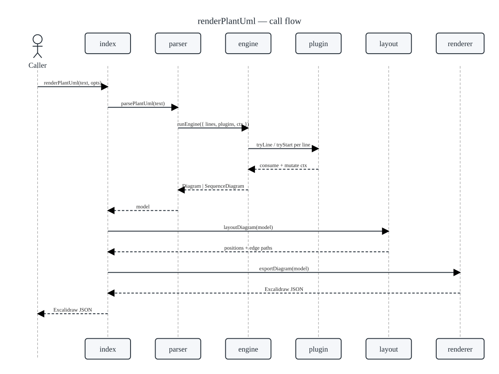
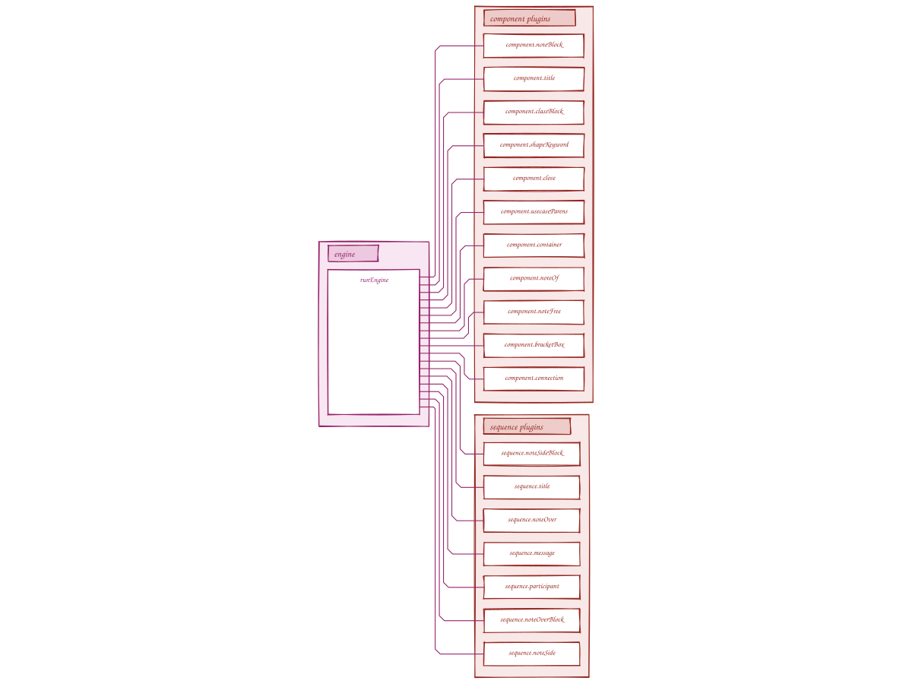
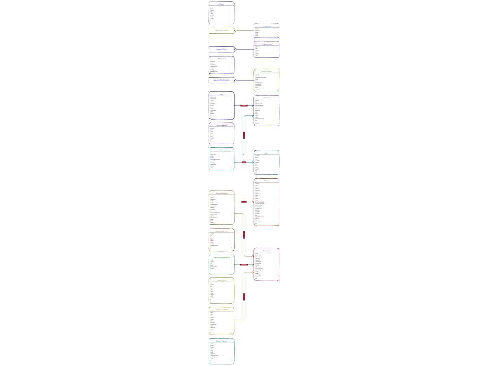

# excaliplant

[](https://www.npmjs.com/package/@grethel-labs/excaliplant)
[](https://www.npmjs.com/package/@grethel-labs/excaliplant)
[](https://github.com/grethel-labs/excaliplant/actions/workflows/ci.yml)
[](https://nodejs.org)
[](./LICENSE)

> PlantUML → ELK layout → Excalidraw renderer with a plugin-based parser. &nbsp;·&nbsp; **v0.19.6** &nbsp;·&nbsp; 265 tests &nbsp;·&nbsp; MIT

`@grethel-labs/excaliplant` takes PlantUML source, runs it through a plugin-based
parser, lays it out with [ELK](https://github.com/kieler/elkjs), and
emits a `.excalidraw` JSON document — opening cleanly in any
Excalidraw front-end. Optional helpers convert the result to SVG or
PNG so the same pipeline can also produce static documentation
artefacts.

<table>
  <tr>
    <td align="center" width="50%">
      <a href="docs/ressources/generated/svg/modules.svg"></a><br/>
      <sub><b>Module structure</b> — rendered by excaliplant itself</sub>
    </td>
    <td align="center" width="50%">
      <a href="docs/ressources/generated/svg/sequence.svg"></a><br/>
      <sub><b>renderPlantUml flow</b> — rendered by excaliplant itself</sub>
    </td>
  </tr>
</table>

> ⚠️ This README is generated. Edit
> [`docs/README.template.md.njk`](./docs/README.template.md.njk) and
> run `npm run build:docs`.

> **AI-generated project notice:** This repository, including source code,
> documentation, comments, and generated artefacts, was created almost entirely
> with AI assistance. The maintainer does not adopt every generated sentence,
> implementation detail, or artefact as a personal statement, endorsement, or
> guarantee. Review everything carefully and use the code at your own risk; the
> MIT License warranty disclaimer applies.

---

## How to use

### Install

```sh
npm install @grethel-labs/excaliplant
```

`@resvg/resvg-js` is pulled in as a runtime dependency so the SVG and
PNG export paths work out of the box.

### Render PlantUML to an Excalidraw document

```js
import { renderPlantUml } from "@grethel-labs/excaliplant";

const excalidraw = await renderPlantUml(plantumlText, { sourceLabel: "demo" });
// → write `excalidraw` to disk as <name>.excalidraw, or hand it to an
//   Excalidraw embed.
```

### Render to SVG / PNG

The result of `renderPlantUml(...)` is a thenable — you can `await` it
to get the Excalidraw JSON, or chain `.toSvg()` / `.toPng()` on it to
get the rasterised diagram in a single line. Both outputs keep the
hand-drawn Excalidraw look (strokes are produced via `roughjs`, the
same library Excalidraw uses internally).

```js
import { renderPlantUml } from "@grethel-labs/excaliplant";

const svg = await renderPlantUml(plantumlText).toSvg();
const png = await renderPlantUml(plantumlText).toPng({ width: 4800 });
```

The lower-level helpers are still exported if you need them:

```js
import {
  renderPlantUml,
  excalidrawJsonToCanvasSvg,
  svgToPng,
} from "@grethel-labs/excaliplant";

const doc = await renderPlantUml(plantumlText);
const svg = excalidrawJsonToCanvasSvg(doc, { width: 1200 });
const png = svgToPng(svg, { width: 4800 });   // 4× SVG width
```

Lower-level entry points are also exported:

| Export                          | Purpose                                          |
| ------------------------------- | ------------------------------------------------ |
| `parsePlantUml(text)`           | PlantUML → `Diagram` model                       |
| `layoutDiagram(diagram)`        | Sizing + ELK layout + edge routing               |
| `exportDiagram(diagram)`        | Diagram → Excalidraw JSON                        |
| `excalidrawToSvg(doc)`          | Excalidraw JSON → tightly-cropped SVG            |
| `excalidrawJsonToCanvasSvg(…)`  | …same, letter-boxed onto a fixed-aspect canvas   |
| `svgToPng(svg)`                 | Rasterise SVG to PNG (`@resvg/resvg-js`)         |

The complete list of exported symbols, with parameter tables and
return types, lives in [`docs/API.md`](./docs/API.md). It is
regenerated from JSDoc on every `npm run build:docs` run.

### Sequence diagram coverage

Sequence diagrams support participants (`participant`, `actor`,
`boundary`, `control`, `entity`, `database`, `collections`, `queue`),
quoted aliases in both `Name as Alias` and `Alias as "Name"` forms,
message arrows including async/reply/reverse/bidirectional variants,
notes, participant `box ... end box` groups, `ref over` references,
dividers (`== label ==`), delays (`... label ...`), spacers (`|||` /
`||45||`), `autonumber` start/stop/resume, lifecycle controls (`create`, `activate`,
`deactivate`, `destroy`) and inline message lifecycle suffixes
(`++`, `--`, `**`, `!!`). Combined fragments render for `opt`,
`loop`, `alt`/`else`, `par`/`and`, `break`, `critical`/`option`, and
`group`/`option` blocks. A small sequence `skinparam` subset maps
directly to output colours in block or compact form: `ArrowColor`,
`ParticipantBackgroundColor`, `ParticipantBorderColor`, and
`LifeLineBorderColor`; supported CSS-like `<style>` blocks safely map
participant, arrow, note, group, lifeline, divider, and activation-bar
colour properties. Graph diagrams also support a sanitized colour subset
for common `skinparam` keys and CSS-like `<style>` selectors covering
backgrounds, component-style boxes, arrows, edge labels, notes, and
containers. Shared PlantUML presentation commands such as
`title`, `caption`, `header`, `footer`, `legend`, and `mainframe`
are preserved in parsed models and rendered where supported; PlantUML
links in graph labels and sequence message labels are kept as safe
Excalidraw link metadata. Creole and legacy HTML-like label markup
degrades to readable plain text across supported diagram families,
including emphasis, headings, lists, tables, Unicode notation, and
icon placeholders.

See the full [Sequence Diagram Component Coverage](./docs/sequence-components.md) for detailed examples and support matrix.

See the generated [Diagram Module Coverage Gallery](./docs/module-coverage.md) for rendered small and complex examples across diagram modules. The gallery includes SVG artefacts for edge cases, overlap-prone layouts, functional decisions, deliberate design choices, wild feature combinations, and repo-derived examples where the diagram type naturally maps to the source tree.

### UML graph diagram coverage

Class diagrams support the common PlantUML class-family declarations
(`class`, `abstract`, `interface`, `enum`, `annotation`, `entity`,
`protocol`, `struct`, `record`, `dataclass`, and related aliases),
generic headers, `extends` / `implements`, class body members and
separators, colon member rows, implicit relationship endpoints,
inheritance, realization, composition, aggregation, dependency and
association arrows, multiplicities, member-qualified arrows,
association classes, qualified associations, packages/namespaces, notes
on classes, members and links, JSON/object display blocks, hide/show/
remove/restore filters, and sanitized graph colours/styles.

Object diagrams support object declarations, quoted aliases, field rows,
body fields, class-style relationships with implicit object endpoints,
association-object diamonds, map/associative-array tables, row anchors
via `Map::key`, row-to-object links, PERT-style map nodes, JSON display
blocks, shared graph notes/styles/presentation, and underlined object
titles in generated Excalidraw output.

Activity diagrams support the practical PlantUML activity core: beta
`:action;` flows with multiline text, start/stop/end/kill/detach,
if/else/switch/while/repeat/fork/split controls, swimlanes, partitions,
notes, connectors, goto/label, simple `-`/`*` action lists,
SDL-style stereotypes, and legacy `(*) --> "Activity"` arrows with
labels. Activity output uses the shared graph layout/rendering pipeline
for deterministic Excalidraw, SVG, and PNG artefacts.

Component diagrams support bracket and keyword component declarations,
aliases, multiline labels, optional interface endpoints, lollipop
interfaces, packages/nodes/folders/frames/clouds/databases, direction
hints, styled arrows, notes including note-on-link, presentation
metadata, hidden edges, `port` / `portin` / `portout` declarations,
`Component::port` anchors, JSON display blocks, and shared
hide/remove/restore and style handling.

Deployment diagrams support official deployment elements such as
`node`, `artifact`, `folder`, `frame`, `cloud`, `database`, `queue`,
`card`, `package`, `stack`, `storage`, `agent`, `file`, `process`,
and `action`; nested containers; aliases; bracketed long descriptions;
JSON display blocks; styled arrows; implicit node endpoints; and shared
graph notes, presentation, filters, and style handling.

State diagrams support simple and composite states, aliases, start/end,
choice, fork, join, history and deep-history pseudostates, state
descriptions, nested state blocks, orthogonal region separators, labelled
transitions, direction hints, inline colours, notes, JSON display blocks,
scale/layout controls, hide-empty-description commands, and shared graph
presentation/style handling.

Timing diagrams support PlantUML `robust`, `concise`, `binary`, `clock`,
`analog`, and `rectangle` participant declarations, aliases, participant
state lists, absolute and relative time markers, anchored times, state
changes, binary and clock waveforms, analog polylines, cross-participant
messages, duration constraints, highlights, top/bottom notes, scale and
hidden-axis controls, footbox/resource hiding directives, separators, and
safe text/colour handling on a deterministic shared time axis.

### Data, Grammar, and Math Diagram Coverage

Regex diagrams support `@startregex` sources with literal text, shorthand and
range character classes, escaped and unicode categories, groups, lookaround-like
assertion groups, anchors, alternatives, and repetition operators. They render as
bounded railroad-style graph diagrams.

EBNF diagrams support `@startebnf` rules with terminals, non-terminals,
sequences, alternatives, optional blocks, repetition blocks, grouping, special
sequences, comments/notes, and documented style/pragma lines tolerated by the
parser. They share the railroad-style graph output used by regex diagrams.

JSON diagrams support `@startjson` objects, arrays, strings, numbers, booleans,
`null`, empty objects/arrays, unicode and escape sequences through the platform
JSON parser, plus PlantUML `#highlight` paths. YAML diagrams support the
documented safe subset for mappings, sequences, scalars, symbol/unicode keys,
and `#highlight` paths. Both render nested data as deterministic graph trees.

Math support covers standalone `@startmath` / `@startlatex` formula diagrams and
inline `<math>` / `<latex>` tags in existing labels. The renderer intentionally
uses a safe readable text fallback instead of pulling in external formula
rendering dependencies.

### Network, UI, and Architecture Coverage

Network diagrams support `@startnwdiag` with `nwdiag` network lanes, address
metadata, groups, devices, multi-homed device declarations, and peer
connections. Devices render through the shared graph pipeline so labels are
measured and routed deterministically.

Salt diagrams support `@startsalt` wireframes with low-fidelity labels,
buttons, radio buttons, checkboxes, text fields, dropdowns, tabs, grid/table
rows, and textarea-style blocks. Unsupported Salt decoration degrades to safe
readable labels instead of raw markup.

Archimate diagrams support `archimate` element declarations with categories,
aliases, stereotypes, junction declarations, simple rectangle states, and
directed relationships. External sprites and stdlib-specific icons use safe
text/type fallbacks.

### Planning, Hierarchy, and Files Coverage

Gantt diagrams support `@startgantt` task declarations with durations, explicit
starts and ends, milestones, project starts, separators, and simple task
dependencies. The parser records scheduling details on deterministic task boxes
and routes dependencies through the shared graph pipeline.

Mindmap and WBS diagrams support PlantUML OrgMode-style markers, Markdown-style
heading/list input, side/direction directives, mixed `*` / `+` hierarchy
markers, and safe text handling. Files diagrams support `@startfiles` path trees
with shared folder merging and file/folder stereotypes.

Chronology diagrams support dated milestones, labelled timestamp entries, simple
ranges, start/end directives, and dependencies between events. Unsupported
calendar-specific presentation lines are tolerated so useful chronology content
still renders as safe readable timeline graphs.

### Entity Relationship Coverage

Information Engineering diagrams support PlantUML `entity` declarations with
attribute rows plus crow-foot relationship operators such as `}|..||`,
`}o..o|`, `||--o{`, and `|o--||`. Cardinality and optionality markers are kept
as endpoint labels so exported diagrams remain deterministic and reviewable.

Chen ER diagrams support `@startchen` entity, relationship, attribute,
derived-attribute, multi-valued-attribute, and key declarations, including
empty or member-bearing blocks, simple orientation directives, aliases, and
cardinality-labelled connections such as `Person -N- Birthplace`.

### Special Rendering Coverage

Ditaa diagrams support `@startditaa` blocks and inline `ditaa(...)` sources.
The parser preserves bounded ASCII canvas lines, consumes common rendering
options such as no-separator, no-shadow, and scale hints, and emits a safe
deterministic Excalidraw graph representation instead of executing an external
Ditaa renderer.

Chart diagrams support `@startchart` sources with horizontal and vertical axes,
bar, line, area, and scatter series, labels, colours, legends, orientation, and
stacking options. Series and option rows render as reviewable graph-backed
chart metadata with the same SVG escaping and layout bounds as other diagram
families.

Use-case diagrams support actor and usecase declarations in keyword,
colon, parenthesized, quoted-alias, reverse-description, stereotype, and
business `/` forms; nested `package` / `rectangle` system boundaries;
include, extend, generalization, directional, labelled, and inline-styled
relationships; notes attached to aliases or usecases; and shared graph
presentation, link, text-markup, skinparam, and `<style>` handling.

### Run the tests

```sh
npm test
```

Ships with **265 tests** across functional, edge-case,
security (XSS / ReDoS / prototype-pollution), and self-introspection
suites.

---

## Self-rendered architecture diagrams

The diagrams below are produced **by excaliplant itself** at build
time from PlantUML sources that describe this very repository. The
text under each image is extracted from the source via `@diagram`
JSDoc tags.

### Module structure


_Sources: [PlantUML](docs/ressources/generated/puml/modules.puml) · [SVG](docs/ressources/generated/svg/modules.svg)_

The module graph reflects how the source is laid out under
[`src/`](./src/). Diagram-type behavior is collected in first-class
module folders under `src/diagrams/`, orchestration lives under
`src/main/`, and host capabilities live under `src/general/platform/`.

### renderPlantUml flow


_Sources: [PlantUML](docs/ressources/generated/puml/sequence.puml) · [SVG](docs/ressources/generated/svg/sequence.svg)_

The call graph for `renderPlantUml(text)` walks three subsystems:

1. **parser** turns PlantUML text into a model (`Diagram` /
   `SequenceDiagram`). The parser is plugin-driven; see the next
   diagram for the plugin breakdown.
2. **layout** decides positions. Component diagrams go through ELK
   (layered + orthogonal routing); sequence diagrams use a small
   deterministic tabular layout.
3. **renderer** walks the laid-out model and emits Excalidraw JSON.
   The same model can also be exported to SVG via
   [`src/general/render/svg.mjs`](./src/general/render/svg.mjs) — used by the
   documentation pipeline.

### Parser plugins



_Sources: [PlantUML](docs/ressources/generated/puml/plugins.puml) · [SVG](docs/ressources/generated/svg/plugins.svg)_

Each parser plugin is a tiny self-contained file that handles ONE
PlantUML construct. The engine offers each input line to plugins
in registration order; the first plugin that returns `true` wins.

To add support for a new PlantUML keyword, drop a new file in the
owning diagram module folder and append it to that module's parser
contract. No engine change required.

### Model classes



_Sources: [PlantUML](docs/ressources/generated/puml/model.puml) · [SVG](docs/ressources/generated/svg/model.svg)_

The model diagram is generated dynamically from exported classes in
[`src/general/model/diagram.mjs`](./src/general/model/diagram.mjs). It shows how the
reusable arrow classes sit underneath both component connections and
sequence messages, so future model classes appear in the README without
hand-maintained PlantUML.

## Pipeline

```text
PlantUML text
     │ parsePlantUml()
     ▼
  Diagram (planes, subplanes, boxes, connections)
     │ layoutDiagram()  (sizing → ELK layered + orthogonal routing → chamfer)
     ▼
  Diagram with absolute positions and edge paths
     │ exportDiagram()
     ▼
  Excalidraw JSON
     │ excalidrawJsonToCanvasSvg()  (optional)
     ▼
  SVG  ── svgToPng() ──▶  PNG  (both optional, no headless browser)
```

## Repository layout

```text
excaliplant
├── assets
│   ├── arrowheads
│   │   ├── arrowheads.svg
│   │   └── manifest.json
│   └── fonts
│       ├── Excalifont-Regular.ttf
│       ├── Excalifont-Regular.woff2
│       └── LICENSE.txt
├── bin
│   └── excaliplant.mjs
├── docs
│   ├── ressources
│   │   ├── module-coverage
│   │   │   ├── archimate
│   │   │   ├── chart
│   │   │   ├── chen
│   │   │   ├── chronology
│   │   │   ├── class
│   │   │   ├── component
│   │   │   ├── deployment
│   │   │   ├── ditaa
│   │   │   ├── ebnf
│   │   │   ├── files
│   │   │   ├── gantt
│   │   │   ├── ie
│   │   │   ├── json
│   │   │   ├── math
│   │   │   ├── mindmap
│   │   │   ├── nwdiag
│   │   │   ├── object
│   │   │   ├── regex
│   │   │   ├── salt
│   │   │   ├── sequence
│   │   │   ├── state
│   │   │   ├── timing
│   │   │   ├── wbs
│   │   │   └── yaml
│   │   └── sequence
│   │       ├── puml
│   │       └── svg
│   ├── scripts
│   │   ├── build-docs.mjs
│   │   ├── build-module-coverage.mjs
│   │   ├── build-sequence-coverage.mjs
│   │   ├── check-build-manifest.mjs
│   │   ├── config.mjs
│   │   ├── extract-api.mjs
│   │   ├── extract-docs.mjs
│   │   ├── file-tree.mjs
│   │   ├── module-coverage-sources.mjs
│   │   └── self-diagrams.mjs
│   ├── API.md
│   ├── API.template.md.njk
│   ├── README.template.md.njk
│   ├── module-coverage.md
│   ├── module-coverage.template.md.njk
│   ├── sequence-components.md
│   ├── sequence-components.template.md.njk
│   └── src-structure-refactor-plan.md
├── scripts
│   ├── auto-patch-deps.mjs
│   ├── bump-release-version.mjs
│   ├── clean-test-output.mjs
│   ├── merge-driver-prefer-higher-version.mjs
│   ├── prepublish-guard.mjs
│   ├── setup-merge-drivers.mjs
│   └── smoke.mjs
├── src
│   ├── diagrams
│   │   ├── activity
│   │   │   ├── plugins
│   │   │   ├── tests
│   │   │   ├── assets.mjs
│   │   │   ├── docs.mjs
│   │   │   ├── layout.mjs
│   │   │   ├── module.mjs
│   │   │   ├── parser.mjs
│   │   │   ├── render.mjs
│   │   │   ├── security.mjs
│   │   │   └── tests.mjs
│   │   ├── archimate
│   │   │   ├── docs
│   │   │   ├── tests
│   │   │   ├── assets.mjs
│   │   │   ├── docs.mjs
│   │   │   ├── layout.mjs
│   │   │   ├── module.mjs
│   │   │   ├── parser.mjs
│   │   │   ├── render.mjs
│   │   │   ├── security.mjs
│   │   │   └── tests.mjs
│   │   ├── base
│   │   │   ├── artifacts.mjs
│   │   │   ├── assets.mjs
│   │   │   ├── dependencies.mjs
│   │   │   ├── docs.mjs
│   │   │   ├── index.mjs
│   │   │   ├── layout.mjs
│   │   │   ├── module.mjs
│   │   │   ├── parser.mjs
│   │   │   ├── renderer.mjs
│   │   │   ├── security.mjs
│   │   │   └── tests.mjs
│   │   ├── chart
│   │   │   ├── docs
│   │   │   ├── tests
│   │   │   ├── assets.mjs
│   │   │   ├── docs.mjs
│   │   │   ├── layout.mjs
│   │   │   ├── module.mjs
│   │   │   ├── parser.mjs
│   │   │   ├── render.mjs
│   │   │   ├── security.mjs
│   │   │   └── tests.mjs
│   │   ├── chen
│   │   │   ├── docs
│   │   │   ├── tests
│   │   │   ├── assets.mjs
│   │   │   ├── docs.mjs
│   │   │   ├── layout.mjs
│   │   │   ├── module.mjs
│   │   │   ├── parser.mjs
│   │   │   ├── render.mjs
│   │   │   ├── security.mjs
│   │   │   └── tests.mjs
│   │   ├── chronology
│   │   │   ├── docs
│   │   │   ├── tests
│   │   │   ├── assets.mjs
│   │   │   ├── docs.mjs
│   │   │   ├── layout.mjs
│   │   │   ├── module.mjs
│   │   │   ├── parser.mjs
│   │   │   ├── render.mjs
│   │   │   ├── security.mjs
│   │   │   └── tests.mjs
│   │   ├── class
│   │   │   ├── docs
│   │   │   ├── plugins
│   │   │   ├── tests
│   │   │   ├── assets.mjs
│   │   │   ├── docs.mjs
│   │   │   ├── layout.mjs
│   │   │   ├── module.mjs
│   │   │   ├── parser.mjs
│   │   │   ├── render.mjs
│   │   │   ├── security.mjs
│   │   │   ├── style.mjs
│   │   │   └── tests.mjs
│   │   ├── component
│   │   │   ├── docs
│   │   │   ├── plugins
│   │   │   ├── tests
│   │   │   ├── assets.mjs
│   │   │   ├── docs.mjs
│   │   │   ├── layout.mjs
│   │   │   ├── module.mjs
│   │   │   ├── parser.mjs
│   │   │   ├── render.mjs
│   │   │   ├── security.mjs
│   │   │   └── tests.mjs
│   │   ├── deployment
│   │   │   ├── docs
│   │   │   ├── plugins
│   │   │   ├── tests
│   │   │   ├── assets.mjs
│   │   │   ├── docs.mjs
│   │   │   ├── layout.mjs
│   │   │   ├── module.mjs
│   │   │   ├── parser.mjs
│   │   │   ├── render.mjs
│   │   │   ├── security.mjs
│   │   │   └── tests.mjs
│   │   ├── ditaa
│   │   │   ├── docs
│   │   │   ├── tests
│   │   │   ├── assets.mjs
│   │   │   ├── docs.mjs
│   │   │   ├── layout.mjs
│   │   │   ├── module.mjs
│   │   │   ├── parser.mjs
│   │   │   ├── render.mjs
│   │   │   ├── security.mjs
│   │   │   └── tests.mjs
│   │   ├── ebnf
│   │   │   ├── docs
│   │   │   ├── tests
│   │   │   ├── assets.mjs
│   │   │   ├── docs.mjs
│   │   │   ├── layout.mjs
│   │   │   ├── module.mjs
│   │   │   ├── parser.mjs
│   │   │   ├── render.mjs
│   │   │   ├── security.mjs
│   │   │   └── tests.mjs
│   │   ├── files
│   │   │   ├── docs
│   │   │   ├── tests
│   │   │   ├── assets.mjs
│   │   │   ├── docs.mjs
│   │   │   ├── layout.mjs
│   │   │   ├── module.mjs
│   │   │   ├── parser.mjs
│   │   │   ├── render.mjs
│   │   │   ├── security.mjs
│   │   │   └── tests.mjs
│   │   ├── gantt
│   │   │   ├── docs
│   │   │   ├── tests
│   │   │   ├── assets.mjs
│   │   │   ├── docs.mjs
│   │   │   ├── layout.mjs
│   │   │   ├── module.mjs
│   │   │   ├── parser.mjs
│   │   │   ├── render.mjs
│   │   │   ├── security.mjs
│   │   │   └── tests.mjs
│   │   ├── ie
│   │   │   ├── docs
│   │   │   ├── tests
│   │   │   ├── assets.mjs
│   │   │   ├── docs.mjs
│   │   │   ├── layout.mjs
│   │   │   ├── module.mjs
│   │   │   ├── parser.mjs
│   │   │   ├── render.mjs
│   │   │   ├── security.mjs
│   │   │   └── tests.mjs
│   │   ├── json
│   │   │   ├── docs
│   │   │   ├── tests
│   │   │   ├── assets.mjs
│   │   │   ├── docs.mjs
│   │   │   ├── layout.mjs
│   │   │   ├── module.mjs
│   │   │   ├── parser.mjs
│   │   │   ├── render.mjs
│   │   │   ├── security.mjs
│   │   │   └── tests.mjs
│   │   ├── math
│   │   │   ├── docs
│   │   │   ├── tests
│   │   │   ├── assets.mjs
│   │   │   ├── docs.mjs
│   │   │   ├── layout.mjs
│   │   │   ├── module.mjs
│   │   │   ├── parser.mjs
│   │   │   ├── render.mjs
│   │   │   ├── security.mjs
│   │   │   └── tests.mjs
│   │   ├── mindmap
│   │   │   ├── docs
│   │   │   ├── tests
│   │   │   ├── assets.mjs
│   │   │   ├── docs.mjs
│   │   │   ├── layout.mjs
│   │   │   ├── module.mjs
│   │   │   ├── parser.mjs
│   │   │   ├── render.mjs
│   │   │   ├── security.mjs
│   │   │   └── tests.mjs
│   │   ├── nwdiag
│   │   │   ├── docs
│   │   │   ├── tests
│   │   │   ├── assets.mjs
│   │   │   ├── docs.mjs
│   │   │   ├── layout.mjs
│   │   │   ├── module.mjs
│   │   │   ├── parser.mjs
│   │   │   ├── render.mjs
│   │   │   ├── security.mjs
│   │   │   └── tests.mjs
│   │   ├── object
│   │   │   ├── docs
│   │   │   ├── plugins
│   │   │   ├── tests
│   │   │   ├── assets.mjs
│   │   │   ├── docs.mjs
│   │   │   ├── layout.mjs
│   │   │   ├── module.mjs
│   │   │   ├── parser.mjs
│   │   │   ├── render.mjs
│   │   │   ├── security.mjs
│   │   │   └── tests.mjs
│   │   ├── regex
│   │   │   ├── docs
│   │   │   ├── tests
│   │   │   ├── assets.mjs
│   │   │   ├── docs.mjs
│   │   │   ├── layout.mjs
│   │   │   ├── module.mjs
│   │   │   ├── parser.mjs
│   │   │   ├── render.mjs
│   │   │   ├── security.mjs
│   │   │   └── tests.mjs
│   │   ├── salt
│   │   │   ├── docs
│   │   │   ├── tests
│   │   │   ├── assets.mjs
│   │   │   ├── docs.mjs
│   │   │   ├── layout.mjs
│   │   │   ├── module.mjs
│   │   │   ├── parser.mjs
│   │   │   ├── render.mjs
│   │   │   ├── security.mjs
│   │   │   └── tests.mjs
│   │   ├── sequence
│   │   │   ├── docs
│   │   │   ├── plugins
│   │   │   ├── tests
│   │   │   ├── assets.mjs
│   │   │   ├── context.mjs
│   │   │   ├── docs.mjs
│   │   │   ├── layout.mjs
│   │   │   ├── layout_engine.mjs
│   │   │   ├── module.mjs
│   │   │   ├── parser.mjs
│   │   │   ├── render.mjs
│   │   │   ├── render_excalidraw.mjs
│   │   │   ├── security.mjs
│   │   │   ├── spacing.mjs
│   │   │   └── tests.mjs
│   │   ├── shared
│   │   │   ├── common_plugins
│   │   │   ├── graph_plugins
│   │   │   ├── data_runtime.mjs
│   │   │   ├── er_runtime.mjs
│   │   │   ├── graph_context.mjs
│   │   │   ├── graph_parser.mjs
│   │   │   ├── graph_runtime.mjs
│   │   │   ├── planning_runtime.mjs
│   │   │   ├── railroad_runtime.mjs
│   │   │   ├── special_runtime.mjs
│   │   │   └── tree_runtime.mjs
│   │   ├── state
│   │   │   ├── docs
│   │   │   ├── plugins
│   │   │   ├── tests
│   │   │   ├── assets.mjs
│   │   │   ├── docs.mjs
│   │   │   ├── layout.mjs
│   │   │   ├── module.mjs
│   │   │   ├── parser.mjs
│   │   │   ├── render.mjs
│   │   │   ├── security.mjs
│   │   │   └── tests.mjs
│   │   ├── timing
│   │   │   ├── docs
│   │   │   ├── plugins
│   │   │   ├── tests
│   │   │   ├── assets.mjs
│   │   │   ├── docs.mjs
│   │   │   ├── layout.mjs
│   │   │   ├── module.mjs
│   │   │   ├── parser.mjs
│   │   │   ├── render.mjs
│   │   │   ├── render_excalidraw.mjs
│   │   │   ├── security.mjs
│   │   │   └── tests.mjs
│   │   ├── use-case
│   │   │   ├── plugins
│   │   │   ├── tests
│   │   │   ├── assets.mjs
│   │   │   ├── docs.mjs
│   │   │   ├── layout.mjs
│   │   │   ├── module.mjs
│   │   │   ├── parser.mjs
│   │   │   ├── render.mjs
│   │   │   ├── security.mjs
│   │   │   └── tests.mjs
│   │   ├── wbs
│   │   │   ├── docs
│   │   │   ├── tests
│   │   │   ├── assets.mjs
│   │   │   ├── docs.mjs
│   │   │   ├── layout.mjs
│   │   │   ├── module.mjs
│   │   │   ├── parser.mjs
│   │   │   ├── render.mjs
│   │   │   ├── security.mjs
│   │   │   └── tests.mjs
│   │   ├── yaml
│   │   │   ├── docs
│   │   │   ├── tests
│   │   │   ├── assets.mjs
│   │   │   ├── docs.mjs
│   │   │   ├── layout.mjs
│   │   │   ├── module.mjs
│   │   │   ├── parser.mjs
│   │   │   ├── render.mjs
│   │   │   ├── security.mjs
│   │   │   └── tests.mjs
│   │   └── index.mjs
│   ├── general
│   │   ├── layout
│   │   │   ├── elk_layout.mjs
│   │   │   └── sizing.mjs
│   │   ├── model
│   │   │   └── diagram.mjs
│   │   ├── platform
│   │   │   ├── asset_base.mjs
│   │   │   ├── diagnostics.mjs
│   │   │   ├── security_base.mjs
│   │   │   └── services.mjs
│   │   ├── render
│   │   │   ├── canvas_svg.mjs
│   │   │   ├── excalidraw.mjs
│   │   │   ├── png.mjs
│   │   │   ├── rng.mjs
│   │   │   ├── schema.mjs
│   │   │   └── svg.mjs
│   │   └── style
│   │       ├── colors.mjs
│   │       ├── font.mjs
│   │       ├── style.mjs
│   │       └── text.mjs
│   ├── main
│   │   ├── builtin.mjs
│   │   ├── dependencies.mjs
│   │   ├── introspection.mjs
│   │   ├── metadata.mjs
│   │   ├── parser.mjs
│   │   ├── pipeline.mjs
│   │   └── registry.mjs
│   └── util
│       ├── parser_engine.mjs
│       └── plantuml_utils.mjs
├── tests
│   ├── helpers
│   │   └── output.mjs
│   ├── activity_components.test.mjs
│   ├── class_components.test.mjs
│   ├── component_components.test.mjs
│   ├── deployment_components.test.mjs
│   ├── edge_cases.test.mjs
│   ├── functional_more.test.mjs
│   ├── merge_driver.test.mjs
│   ├── modular_architecture.test.mjs
│   ├── module_coverage.test.mjs
│   ├── object_components.test.mjs
│   ├── plantuml.test.mjs
│   ├── security.test.mjs
│   ├── self_introspection.test.mjs
│   ├── sequence_components.test.mjs
│   ├── state_components.test.mjs
│   ├── style.test.mjs
│   └── usecase_components.test.mjs
├── AGENTS.md
├── CHANGELOG.md
├── CLAUDE.md
├── CONTRIBUTING.md
├── GEMINI.md
├── LICENSE
├── README.md
├── SECURITY.md
├── THIRD_PARTY_NOTICES.md
├── index.mjs
├── lifecycle-test.svg
├── package.json
├── style.example.json
├── style.example.yaml
└── tsconfig.json
```

Generated artefacts (`docs/ressources/generated/`) live in
`.gitignore` — they are rebuilt by `npm run build:docs`. The
single-page API reference at [`docs/API.md`](./docs/API.md) is
generated by the same command from JSDoc.

## Module documentation

### diagrams


### diagrams/activity/assets


### diagrams/activity/docs


### diagrams/activity/layout


### diagrams/activity/module


### diagrams/activity/parser


### diagrams/activity/plugins/syntax


### diagrams/activity/render


### diagrams/activity/security


### diagrams/activity/tests


### diagrams/activity/tests/activity_components


### diagrams/base


### diagrams/base/artifacts


### diagrams/base/assets


### diagrams/base/dependencies


### diagrams/base/docs


### diagrams/base/layout


### diagrams/base/module


### diagrams/base/parser


### diagrams/base/renderer


### diagrams/base/security


### diagrams/base/tests


### diagrams/class/assets


### diagrams/class/docs


### diagrams/class/docs/coverage_examples


### diagrams/class/layout


### diagrams/class/module


### diagrams/class/parser


### diagrams/class/plugins/syntax


### diagrams/class/render


### diagrams/class/security


### diagrams/class/style


### diagrams/class/tests


### diagrams/component/assets


### diagrams/component/docs


### diagrams/component/docs/coverage_examples


### diagrams/component/layout


### diagrams/component/module


### diagrams/component/parser


### diagrams/component/plugins/syntax


### diagrams/component/render


### diagrams/component/security


### diagrams/component/tests


### diagrams/deployment/assets


### diagrams/deployment/docs


### diagrams/deployment/layout


### diagrams/deployment/module


### diagrams/deployment/parser


### diagrams/deployment/plugins/syntax


### diagrams/deployment/render


### diagrams/deployment/security


### diagrams/deployment/tests


### diagrams/ebnf/parser


### diagrams/object/assets


### diagrams/object/docs


### diagrams/object/docs/coverage_examples


### diagrams/object/layout


### diagrams/object/module


### diagrams/object/parser


### diagrams/object/plugins/syntax


### diagrams/object/render


### diagrams/object/security


### diagrams/object/tests


### diagrams/regex/layout


### diagrams/regex/module


### diagrams/regex/parser


### diagrams/regex/render


### diagrams/sequence/assets


### diagrams/sequence/docs


### diagrams/sequence/layout


### diagrams/sequence/module


### diagrams/sequence/parser


### diagrams/sequence/render


### diagrams/sequence/security


### diagrams/sequence/tests


### diagrams/shared/data_runtime


### diagrams/shared/graph_parser


### diagrams/shared/graph_runtime


### diagrams/shared/railroad_runtime


### diagrams/state/assets


### diagrams/state/docs


### diagrams/state/docs/coverage_examples


### diagrams/state/layout


### diagrams/state/module


### diagrams/state/parser


### diagrams/state/plugins/syntax


### diagrams/state/render


### diagrams/state/security


### diagrams/state/tests


### diagrams/state/tests/output


### diagrams/state/tests/state_components


### diagrams/timing/assets


### diagrams/timing/docs


### diagrams/timing/docs/coverage_examples


### diagrams/timing/layout


### diagrams/timing/module


### diagrams/timing/parser


### diagrams/timing/plugins/syntax


### diagrams/timing/render


### diagrams/timing/render_excalidraw


### diagrams/timing/security


### diagrams/timing/tests


### diagrams/timing/tests/timing_components


### diagrams/use-case/assets


### diagrams/use-case/docs


### diagrams/use-case/layout


### diagrams/use-case/module


### diagrams/use-case/parser


### diagrams/use-case/plugins/actors


### diagrams/use-case/plugins/containers


### diagrams/use-case/plugins/notes


### diagrams/use-case/plugins/relationships


### diagrams/use-case/plugins/usecases


### diagrams/use-case/render


### diagrams/use-case/security


### diagrams/use-case/tests


### layout

Layout chooses positions for every shape and routes every edge.
Component / use-case / deployment diagrams flow through ELK
(`elkjs`) using the `layered` algorithm with orthogonal edge
routing. After ELK returns we chamfer 90° corners so the result
matches Excalidraw's diagonal-corner aesthetic.

Sequence diagrams skip ELK entirely — their layout is strictly
tabular (lifelines on the X axis, time on the Y axis), so a
deterministic ~90-line algorithm produces better, more compact
results than a force-directed solver could.

### main/builtin


### model

Input-agnostic diagram model. Two top-level kinds:

- **`Diagram`** — component / deployment / use-case style
  (planes, subplanes, boxes, connections).
- **`SequenceDiagram`** — lifelines + messages + notes.

Layout and renderer dispatch on the model class. Anything that
can be expressed as one of these two shapes flows through the
pipeline; the parser is just one possible source. Callers can
also build a `Diagram` programmatically and feed it to
`renderDiagram()`.

### modules/dependencies


### modules/introspection


### modules/metadata


### modules/pipeline


### modules/registry


### parser/engine

A ~50-line line-walker. The engine itself knows nothing about
PlantUML syntax; that lives entirely in plugins. Block plugins
(multi-line notes, class bodies) take exclusive ownership of
subsequent lines until they release.

### platform/asset-base


### platform/diagnostics


### platform/security-base


### platform/services


### render

Emits Excalidraw JSON. Each model shape is dispatched to a
dedicated `renderXxx()` function that produces one or more
Excalidraw primitive elements (rectangle, ellipse, line, arrow,
text). The output document is a stand-alone `.excalidraw` file
that any Excalidraw front-end can open. The companion module
`src/general/render/svg.mjs` converts the same JSON to SVG for the
build-time documentation pipeline.

### sequence-spacing

Central spacing contract for sequence diagrams.

Sequence layout has many visual item types (messages, notes, refs,
dividers, fragments, lifecycle bars). They all reserve vertical space
through this module so adding a new timeline item does not introduce a
one-off top/bottom rhythm.

## License

MIT © grethel-labs
