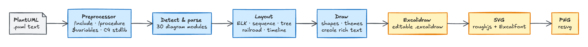

# Architecture

excaliplant turns PlantUML text into Excalidraw scenes. SVG and PNG are
rendered _from_ the Excalidraw scene, so all three outputs always agree.



## Pipeline

| Stage      | Code                                        | Responsibility                                                                                                                                           |
| ---------- | ------------------------------------------- | -------------------------------------------------------------------------------------------------------------------------------------------------------- |
| Source     | `src/core/source.mjs`                       | Split `@startX … @endX` blocks, strip `'` and `/' '/` comments, split `newpage` pages.                                                                   |
| Preprocess | `src/core/preprocess/`                      | Variables, macros, conditionals, loops, procedures, functions, builtins, `!include` via resolver, bundled C4/ArchiMate shims. Fully budgeted.            |
| Resolve    | `src/core/registry.mjs`                     | Pick the module for the block. Dedicated starts (`@startjson`) map directly; `@startuml` uses each module's `detect` score, with `sequence` as fallback. |
| Parse      | `src/diagrams/<kind>/`                      | Lines → model. Shared commands (`title`, `skinparam`, `<style>`, …) via `parseCommon`.                                                                   |
| Theme      | `src/draw/theme.mjs`, `src/syntax/skin.mjs` | Start from a theme (`sketch`, `plain`, `hachure`, `mono`, `dark`, `blueprint`), apply `skinparam`/`<style>` overrides per role.                          |
| Layout     | module + `src/layout/`                      | Geometry. Text is measured with real Excalifont advance widths.                                                                                          |
| Draw       | module + `src/draw/`                        | Shapes and text on the `Canvas`; chrome (title, legend, …) is added by `decorate`.                                                                       |
| Render     | `src/render/`                               | Excalidraw document, SVG via roughjs with the element seeds, PNG via resvg.                                                                              |

## Diagram modules

```js
export default defineDiagram({
  kind: "example",
  title: "Example diagram",
  starts: ["uml"], // or a dedicated start like "example"
  detect: (lines) => score, // only needed for shared starts
  parse: (lines, ctx) => model, // model.meta = createMeta()
  layout: (model, ctx) => laidOut, // may be async
  draw: (laidOut, canvas, ctx) => {},
});
```

Families:

- **Graph diagrams** (class, object, use case, component, deployment, state, ArchiMate, Chen, DOT, legacy activity) share `src/model/graph.mjs` and `src/diagrams/graph/` (declarations, links, notes, containers, ELK layout with hierarchy, shape drawing, edge labels).
- **Custom engines**: sequence (column/row table), activity (structured blocks with port-based orthogonal routing and swimlanes), timing, Gantt, chronology, nwdiag, salt, railroad (EBNF/regex), math box layout, ditaa grid tracing, chart.
- **Trees and data**: mind map / WBS (shared outline parser), files, JSON/YAML (linked tables).

## Canvas and themes

`Canvas` is the single producer of Excalidraw elements (`rect`, `ellipse`,
`diamond`, `line`, `arrow`, `text`, `richText`, `group`). Arrowheads that
Excalidraw lacks (UML cross, socket, crow's-foot variants) are drawn as extra
primitives. Themes map semantic roles (`class`, `note`, `edge`, `participant`,
…) to fills, strokes and text colours, so styling is uniform across diagram
types.

## Determinism and safety

- Element ids and stroke seeds derive from `stableHash32(seed|kind|block|page)`.
- `DEFAULT_LIMITS` bounds input size, lines, preprocessor work, nodes, edges, elements and raster size.
- SVG output escapes every string and validates every colour; links are restricted to `http(s)` and `mailto`.
