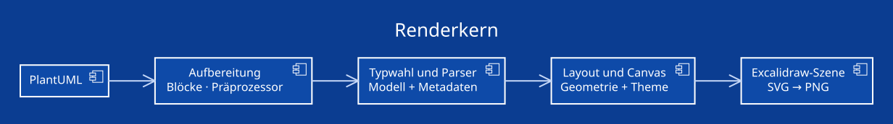
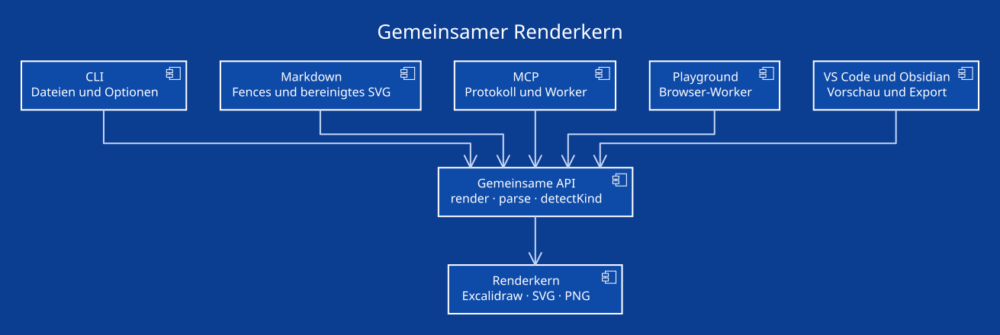
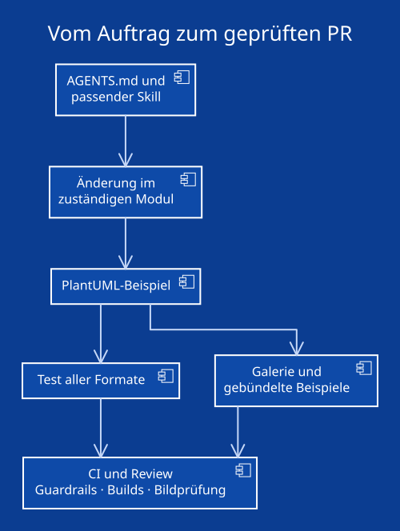
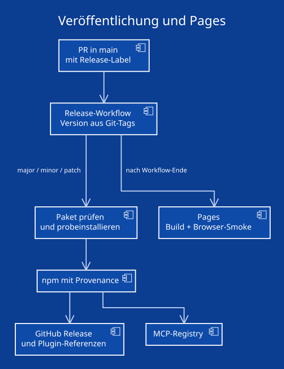

# So entwickeln wir Excaliplant

[AGENTS.md](../../AGENTS.md) ist der Einstieg für Mensch und Agent. Sieben Entwicklungsskills zeigen den Codepfad und die passenden Tests. Drei weitere Skills helfen beim Schreiben von Issues, PR-Beschreibungen und Commit-Nachrichten. Die [Guidelines](guidelines.md) helfen bei Entscheidungen im Review. Die [Guardrails](guardrails.md) zeigen, welche technischen Verträge die CI prüft.

## 1. Renderkern

Der Kern bereitet PlantUML auf und wählt anhand des Start-Tags oder der Syntax den Diagrammtyp. Der Parser liefert ein Modell, das Layout berechnet die Geometrie und Canvas schreibt eine editierbare Szene. SVG und PNG leiten sich aus dieser Szene ab. Limits greifen entlang der Kette.

[Excalidraw öffnen](diagrams/render-pipeline.excalidraw) · [PlantUML-Quelle](diagrams/render-pipeline.puml)

## 2. Schnittstellen

CLI, Markdown, MCP, Playground und Editor-Erweiterungen verwenden dieselbe Engine. Ihre Adapter kümmern sich um Dateiausgabe, Einbettung, Protokoll oder Browser-Worker. Dadurch greift eine Änderung am Diagrammtyp über mehrere Oberflächen.

[Excalidraw öffnen](diagrams/adapters.excalidraw) · [PlantUML-Quelle](diagrams/adapters.puml)

## 3. Änderung und CI

Ein Beispiel kann gleichzeitig Testfall, Galerie-Eintrag und Vorlage für den ausgelieferten Skill oder MCP sein. Die schnellen Guardrails prüfen Modulgrenzen. Verhaltenstests prüfen die Ausgaben, und der Browser-Smoke-Test startet den tatsächlichen Playground-Worker. Das Review ergänzt den Blick auf Lesbarkeit und Auswirkungen.

[Excalidraw öffnen](diagrams/change-validation.excalidraw) · [PlantUML-Quelle](diagrams/change-validation.puml)

## 4. Veröffentlichung

Das PR-Label bestimmt den Versionssprung oder überspringt die Veröffentlichung. Ein Release prüft und installiert das Paket, veröffentlicht es auf npm und erzeugt die Release-Artefakte und Plugin-Referenzen. Pages baut anschließend die Website mit der verfügbaren Version.

[Excalidraw öffnen](diagrams/release-flow.excalidraw) · [PlantUML-Quelle](diagrams/release-flow.puml)
