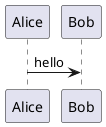

# Markdown

excaliplant renders PlantUML code blocks inside Markdown. A fence with the
language `plantuml`, `puml` or `uml` (any case, backticks or tildes) becomes an
inline SVG or an image link:

````markdown

````

The text between the fences may omit `@startuml` / `@enduml`. Attributes in the
info string (`{…}` is optional) override the global options for one block:

| Attribute      | Meaning                                                   |
| -------------- | --------------------------------------------------------- |
| `theme=<name>` | `sketch`, `plain`, `hachure`, `mono`, `dark`, `blueprint` |
| `clean`        | clean strokes instead of the hand-drawn look              |
| `seed=<value>` | seed for stroke wobble                                    |
| `width=<px>`   | scale the SVG to this width (16–16000)                    |
| `alt="<text>"` | accessible text (default: the diagram title)              |

## Which route do I take?

| You have…                             | Use                                                                                        |
| ------------------------------------- | ------------------------------------------------------------------------------------------ |
| a README on GitHub                    | `excaliplant markdown --mode file` or the GitHub Action                                    |
| a static site (Docusaurus, Astro, …)  | the remark plugin                                                                          |
| markdown-it (VitePress, custom tools) | the markdown-it plugin                                                                     |
| your own tooling                      | `extractBlocks`, `renderBlock`, `renderMarkdown` from `@grethel-labs/excaliplant/markdown` |

GitHub does not render PlantUML fences itself and strips inline `<svg>`. For
GitHub use `--mode file`, which writes `assets/<hash>.svg` and links it with a
normal Markdown image.

## Command line

```sh
excaliplant markdown README.md -o README.out.md      # inline SVG, source dropped
excaliplant markdown README.md --in-place --mode file # assets/<hash>.svg, source kept
excaliplant markdown docs/*.md --check                # CI: exit 1 if anything is stale
cat doc.md | excaliplant markdown - > rendered.md
```

| Option                                        | Meaning                                                            |
| --------------------------------------------- | ------------------------------------------------------------------ |
| `-o, --output <file>`                         | write the result there (one input)                                 |
| `-i, --in-place`                              | rewrite the inputs; implies `--keep-source`                        |
| `--mode inline\|file`                         | `inline` (default) or `file`                                       |
| `--assets-dir <dir>`                          | asset directory for `file` mode, relative to the output (`assets`) |
| `--keep-source[=how]`                         | keep the PlantUML text (`comment` or `details`)                    |
| `--no-keep-source`                            | drop it                                                            |
| `--check`                                     | write nothing; exit 1 if a file or asset would change              |
| `-t, --theme`, `--clean`, `--seed`, `--width` | defaults for all blocks                                            |
| `--max-blocks <n>`                            | diagram budget per document (default 50)                           |
| `-q, --quiet`                                 | hide warnings                                                      |

Exit codes: `0` ok, `1` a diagram failed or `--check` found changes, `2` usage
error. Failed diagrams stay in the document unchanged and are reported as
`file:line: error: message`. Without `-o`/`--in-place` the result goes to
stdout. `--watch` is deliberately not offered; use your editor or build tool's
watcher around the command.

### Keeping the source

With `--keep-source` (always on for `--in-place`) the output carries the
original text, so the document can be updated later:

```markdown
<!-- excaliplant:begin hash=3f2a9c4e1b7d8a60 -->
<!-- excaliplant:source plantuml {theme=dark}
@startuml
Alice %2D%2D> Bob
@enduml
-->


<!-- excaliplant:end -->
```

Running the command again re-renders each marked region from its source, and
the result is byte-identical when nothing changed. Runs of `-` in the source are
percent-escaped (`%2D`), so `-->` in a diagram can never end the comment early.
`--keep-source=details` additionally shows the source in a collapsible
`<details>` block. Do not edit the text between the markers; edit the source
comment, or restore a fence and render again.

The hash covers the diagram text, the options and the excaliplant version, so
**pin the version** (`npx @grethel-labs/excaliplant@1.2.3 …`) when you use
`--check` in CI; a different version produces different SVG.

## GitHub Action

```yaml
name: Diagrams
on: [pull_request]
jobs:
  diagrams:
    runs-on: ubuntu-latest
    permissions:
      contents: read
    steps:
      - uses: actions/checkout@v7
      - uses: grethel-labs/excaliplant@v1 # pin to a release tag or commit SHA
        with:
          files: |
            README.md
            docs/**/*.md
          check: "true"
          version: 1.2.3
```

| Input          | Default     | Meaning                                                           |
| -------------- | ----------- | ----------------------------------------------------------------- |
| `files`        | `README.md` | files or globs, whitespace/newline separated, relative paths only |
| `mode`         | `file`      | `file` or `inline`                                                |
| `assets-dir`   | `assets`    | asset directory relative to each file                             |
| `check`        | `false`     | `true`: fail if anything is stale; `false`: rewrite in place      |
| `keep-source`  | `true`      | keep the PlantUML text in a comment                               |
| `version`      | `latest`    | version of `@grethel-labs/excaliplant` to run                     |
| `theme`        | empty       | theme for all diagrams                                            |
| `node-version` | `22`        | Node.js version                                                   |

Inputs are passed to the script through environment variables only, files and
versions are validated, and the action needs no secrets and no write
permission in `check` mode. To commit regenerated files, run it with
`check: "false"` and add your own commit step (for example on a schedule or on
pushes to a docs branch).

### Pre-commit

```sh
#!/bin/sh
# .git/hooks/pre-commit
git diff --cached --name-only --diff-filter=ACM -- '*.md' | xargs -r \
  npx --yes @grethel-labs/excaliplant@1.2.3 markdown --mode file --in-place -- &&
  git diff --cached --name-only --diff-filter=ACM -- '*.md' | xargs -r git add
```

## markdown-it

````js
import MarkdownIt from "markdown-it";
import excaliplant, { prerender } from "@grethel-labs/excaliplant/markdown-it";

const md = new MarkdownIt().use(excaliplant, { theme: "sketch" });

const text = "```plantuml\nA -> B\n```";
await prerender(md, text); // render all diagrams into the cache
const html = md.render(text); // synchronous and complete
````

markdown-it renders synchronously; excaliplant (ELK layout) does not. The
plugin bridges the two with a content-addressed cache:

- **cache hit**: the fence rule returns the SVG immediately;
- **cache miss**: it returns `<div class="excaliplant excaliplant-pending" data-excaliplant-hash="…">`,
  starts rendering and calls `onRendered(hash)` when finished, so the host can
  render again (live preview);
- `await prerender(md, text)` fills the cache for every block up front, which
  is the right pattern for static builds.

Options: everything `renderBlock` accepts (`theme`, `clean`, `seed`, `width`,
`limits`, …), plus `cache` (share one with `createCache({ max })`),
`onRendered`, `shareFont` (default `true`: only the first diagram of a
`md.render` call embeds the font; pass a fresh `env` per render) and `budget`.
Errors render as `<pre class="excaliplant-error">` boxes. Only `inline` output
is possible; use the CLI for files.

## remark, Docusaurus, Astro

```js
import { unified } from "unified";
import remarkParse from "remark-parse";
import remarkRehype from "remark-rehype";
import rehypeRaw from "rehype-raw";
import rehypeStringify from "rehype-stringify";
import remarkExcaliplant from "@grethel-labs/excaliplant/remark";

const html = await unified()
  .use(remarkParse)
  .use(remarkExcaliplant, { theme: "sketch" })
  .use(remarkRehype, { allowDangerousHtml: true })
  .use(rehypeRaw)
  .use(rehypeStringify)
  .process(markdown);
```

`code` nodes with the language `plantuml`/`puml`/`uml` become `html` nodes with
the sanitised SVG. Extra attributes may come from the fence (`lang` plus
`meta`).

**Astro** passes raw HTML through by default, so the `inline` mode works:

```js
// astro.config.mjs
import remarkExcaliplant from "@grethel-labs/excaliplant/remark";
export default { markdown: { remarkPlugins: [[remarkExcaliplant, { theme: "sketch" }]] } };
```

**Docusaurus** compiles MDX, which does not accept raw `html` nodes. Use the
`file` mode and write the SVGs into `static/`:

```js
// docusaurus.config.js (async config or an ESM module)
import { mkdir, writeFile } from "node:fs/promises";
import path from "node:path";
import remarkExcaliplant from "@grethel-labs/excaliplant/remark";

const remarkPlantuml = [
  remarkExcaliplant,
  {
    mode: "file",
    assetsDir: "static/img/uml", // passed to writeFile
    assetsUrl: "/img/uml", // used in the image URL
    writeFile: async (name, data) => {
      await mkdir(path.dirname(name), { recursive: true });
      await writeFile(name, data);
    },
  },
];
// docs: { remarkPlugins: [remarkPlantuml] }, blog: { remarkPlugins: [remarkPlantuml] }
```

Other remark options: `onError` (`"box"` default, `"keep"`, `"throw"` to fail
the build), `assetsDir`, `assetsUrl`, `shareFont`, `budget`. Messages are also
reported through `file.message` when a vfile is present. A rehype variant is
not provided; remark runs before the HTML conversion in every pipeline.

## API

```js
import {
  extractBlocks,
  renderBlock,
  renderMarkdown,
  runMarkdownCommand,
  createCache,
} from "@grethel-labs/excaliplant/markdown";
```

- `extractBlocks(markdown)` returns `{ lang, source, start, end, fence, info, attrs, line }[]`
  for every PlantUML fence. `markdown.slice(start, end)` is the whole fenced block.
- `renderBlock(source, options)` resolves to `{ svg, hash, diagnostics, kind, title }`
  or `{ hash, diagnostics, error }`; it never throws. Results are cached by a hash
  of source, options and package version (`options.cache`, default: a shared
  LRU; `cache: false` disables it).
- `renderMarkdown(markdown, options)` resolves to `{ markdown, blocks, assets, changed }`.
  Options: `mode`, `keepSource`, `assetsDir`, `assetsUrl`, `writeFile(name, data)`,
  `shareFont`, `budget`, plus the `renderBlock` options. Without `writeFile` the
  asset files are only returned in `assets`.
- `runMarkdownCommand(argv, io)` is the command line entry point (see
  `bin/excaliplant.mjs`); `io` is `{ readFile, writeFile, readStdin?, stdout, stderr, include? }`.

## Limits and safety

- Every block is rendered with the usual limits (`limits` option). A document
  may contain at most 50 diagrams (`budget.maxBlocks`), 1 MiB of diagram source
  and 8 MiB of Markdown; blocks over budget stay untouched and are reported.
- The SVG is rebuilt from an allow-list before it is inlined: no scripts,
  event handlers, `foreignObject`, external images or `url(...)`; links only to
  `http(s)` and `mailto`. The embedded font is the only stylesheet content that
  survives, and the text rule is scoped to `.excaliplant`.
- `!include` works only if you pass an `include` resolver. The CLI does not.
- Fences are detected as CommonMark does (up to three spaces of indentation,
  matching closing fence, nothing inside another fence). Fences nested in list
  items that are indented four or more spaces, and unclosed fences, are left alone.
- Markdown renderers that sanitise HTML (GitHub, most comment systems) drop
  inline SVG; use `file` mode there.
