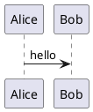

# Obsidian

The **Excaliplant** plugin renders ` ```plantuml `, ` ```puml ` and ` ```uml `
code blocks in Obsidian notes as hand-drawn, Excalidraw-style SVG, in Reading
view and Live Preview. It runs entirely inside Obsidian: no network access, no
telemetry, no account. It is built from this repository (`integrations/obsidian`)
and published through a thin mirror repository,
[`grethel-labs/excaliplant-obsidian`](https://github.com/grethel-labs/excaliplant-obsidian)
(see [Why a mirror repository](#why-a-mirror-repository)).

````markdown

````

The per-block attributes are the ones documented in [Markdown](markdown.md):
`theme`, `clean`, `seed`, `width`, `alt`. `@startuml` / `@enduml` may be omitted.

## Installation

Until the plugin is listed in Obsidian's community directory:

- **BRAT** (beta installer): install the community plugin _Obsidian42 - BRAT_,
  run "BRAT: Add a beta plugin for testing" and enter
  `grethel-labs/excaliplant-obsidian`. BRAT follows new releases.
- **Manually**: download `main.js`, `manifest.json` and `styles.css` from the
  [latest release](https://github.com/grethel-labs/excaliplant-obsidian/releases/latest)
  into `<vault>/.obsidian/plugins/excaliplant/`, restart Obsidian and enable
  _Excaliplant_ under Settings, Community plugins.

Once listed: Settings, Community plugins, Browse, search "Excaliplant".

Requires Obsidian 1.5.7 or newer. The plugin is not desktop-only; it works on
iOS and Android.

## Settings

| Setting                | Default   | Meaning                                                                                                                           |
| ---------------------- | --------- | --------------------------------------------------------------------------------------------------------------------------------- |
| Theme                  | Automatic | `Automatic` uses `sketch` in light mode and `dark` in dark mode; or fix `sketch`, `plain`, `hachure`, `mono`, `dark`, `blueprint` |
| Clean strokes          | off       | straight lines instead of the hand-drawn look                                                                                     |
| Seed                   | empty     | seed for the stroke wobble                                                                                                        |
| Maximum width          | 0         | largest display width in pixels; 0 = width of the note                                                                            |
| Transparent background | off       | let the note background show through (best with the automatic theme)                                                              |
| Show warnings          | off       | list ignored or unsupported lines below each diagram                                                                              |

A block's own attributes win over the settings. Changing a setting redraws all
open diagrams; switching Obsidian between light and dark redraws them when the
theme is automatic.

## Commands

Place the cursor inside a PlantUML block (or have exactly one in the note) and
run from the command palette:

| Command                                  | Result                                                                                                |
| ---------------------------------------- | ----------------------------------------------------------------------------------------------------- |
| Export diagram as .excalidraw attachment | Excalidraw scene file, saved where your attachment settings say                                       |
| Export diagram as SVG attachment         | standalone SVG (Excalifont embedded)                                                                  |
| Export diagram as PNG attachment         | PNG at 2x, rasterised by the browser (Electron or the mobile web view), not by resvg                  |
| Copy diagram as Excalidraw JSON          | clipboard JSON (`type: "excalidraw/clipboard"`) to paste into excalidraw.com or the Excalidraw plugin |

Exports use the theme from the settings (the automatic theme follows the current
mode) and keep the theme background. No commands ship with default hotkeys.
Pasting the clipboard JSON into excalidraw.com or the Obsidian Excalidraw plugin
follows Excalidraw's clipboard format; it has not been verified against every
Excalidraw version. The `.excalidraw` file is the safer exchange format.

## Errors, limits, privacy

- A diagram that does not render shows an error box with the message and the
  line (in the diagram and in the note). Results are cached by content, so
  unchanged diagrams appear instantly.
- Rendering is bounded by the library limits (input size, node and element
  counts); oversized diagrams fail with an error instead of freezing Obsidian.
- `!include` is not available. A note never reads other files; everything else of
  the preprocessor (`!define`, variables, procedures, loops) works.
- The SVG is rebuilt from an allow-list before it is shown (no scripts, event
  handlers, `foreignObject`, external images or `url(...)`; links only to
  `http(s)` and `mailto`) and attached with `DOMParser` and DOM calls, never
  through `innerHTML`.
- Network use: none. Telemetry: none. Files outside the vault: not accessed. The
  plugin stores its settings in the plugin's `data.json`.

## How the bundle is built

`integrations/obsidian/build.mjs` bundles `src/` (the same renderer the library
and the Markdown plugins use) with esbuild for the browser: `platform: "browser"`,
CommonJS, `obsidian`, `electron`, `@codemirror/*` and `@lezer/*` external. Node
built-ins are deliberately **not** external, so any Node-only import fails the
build instead of crashing the plugin on a phone. Four spots of `src/` are Node-only
and are swapped in the bundle only (`src/` itself is unchanged):

| Module                                                  | Replacement (`integrations/obsidian/shims/`)                                    |
| ------------------------------------------------------- | ------------------------------------------------------------------------------- |
| `node:crypto` (SHA-256 of cache keys)                   | `crypto.js`: synchronous FIPS 180-4 SHA-256, tested to match Node byte for byte |
| `node:module` (`createRequire` for the package version) | `module.js`: answers with the version given to the build                        |
| `src/render/font.mjs` (reads the woff2)                 | `font.js`: the woff2 is embedded as base64                                      |
| `src/render/png.mjs` (native resvg)                     | `png.js`: stub; PNG export uses the browser canvas instead                      |

Result: `main.js` has no `require` other than `obsidian` and runs without
`process`, `Buffer` or `fs`, which `test/obsidian-build.test.mjs` verifies by
running the bundle in a `vm` sandbox that has none of them. ELKjs runs through its
bundled single-thread fallback. Size: about 1.86 MB (about 0.6 MB gzipped), of which
ELKjs is 1.5 MB, the renderer 0.29 MB, the embedded font 33 KB.

The mock-based tests are an approximation: they are not a substitute for trying
the plugin on a real phone before a release.

### Develop locally

```sh
cd integrations/obsidian
npm ci            # esbuild and the Obsidian typings; own lockfile, not part of the root install
npm run build     # writes integrations/obsidian/main.js (git-ignored), version 0.0.0
```

Copy or symlink `main.js`, `manifest.json` and `styles.css` into
`<vault>/.obsidian/plugins/excaliplant/` and reload the plugin. The root
`npm test` runs the plugin tests against a mock `obsidian` module; the bundle
tests skip themselves when esbuild is not installed.

### Release files

```sh
node scripts/build-obsidian.mjs --version 1.2.3 --out dist-obsidian \
  [--base-versions <existing versions.json>] [--repo-files]
```

Writes `main.js`, `manifest.json` (version set), `versions.json` and `styles.css`
into `--out`, plus `README.md`, `LICENSE`, `THIRD_PARTY_NOTICES.md` and
`Excalifont-OFL.txt` with `--repo-files`. The versions must be plain `x.y.z`.
The output is byte-reproducible and the working tree is not modified.
`--base-versions` extends the history of an existing `versions.json` (a missing
file starts an empty one); the placeholder `0.0.0` is never published. The repo
carries version `0.0.0` in `manifest.json` and an empty `versions.json`.

## Publishing (maintainer)

> **Status: publishing is disabled.** The `obsidian` job in `.github/workflows/release.yml` only runs when the repository variable `PUBLISH_OBSIDIAN` is `true` (and the `OBSIDIAN_DEPLOY_KEY` secret exists). The plugin is still built in CI and can be installed manually or via BRAT from a local build.

### Rules that apply (Obsidian documentation)

| Topic           | Rule                                                                                                                                                                                     | Source      |
| --------------- | ---------------------------------------------------------------------------------------------------------------------------------------------------------------------------------------- | ----------- |
| Repository root | `README.md`, `LICENSE` and `manifest.json` must be in the root folder of the repository                                                                                                  | [1]         |
| Manifest source | the directory processes `manifest.json` at the HEAD of the repository's default branch                                                                                                   | [1]         |
| Release tag     | the tag of the GitHub release must match the `version` in `manifest.json`; Obsidian installs from that release. Example commands use `git tag -a 1.0.1 -m "1.0.1"`, i.e. no `v` prefix   | [1] [2] [3] |
| Release assets  | `main.js`, `manifest.json` (and optionally `styles.css`) as binary attachments of the release                                                                                            | [1] [2]     |
| Version format  | `x.y.z` only                                                                                                                                                                             | [4]         |
| `versions.json` | maps plugin version to `minAppVersion`; read from the repository root when the user's Obsidian is older than `minAppVersion`; only needs updating when `minAppVersion` changes           | [5]         |
| `id`            | lowercase letters and hyphens only, unique, no `obsidian`, must not end in `plugin`                                                                                                      | [4]         |
| `name`          | Basic Latin; only hyphen, plus, parentheses as punctuation; no "Obsidian", no "Plugin"                                                                                                   | [4]         |
| `description`   | under 250 characters, starts with an action statement, ends with a period, no emoji                                                                                                      | [6]         |
| `isDesktopOnly` | `true` if Node.js or Electron APIs (`fs`, `crypto`, `os`, ...) are used; they do not exist on mobile                                                                                     | [4] [6] [7] |
| Mobile          | regex lookbehind only works on iOS 16.4+                                                                                                                                                 | [7]         |
| Policies        | no obfuscation, no client-side telemetry, no ads, no self-updating; network use, outside-vault file access and closed-source parts must be disclosed in the README; LICENSE required     | [8]         |
| Guidelines      | no `innerHTML`/`outerHTML`/`insertAdjacentHTML` with user input, no default hotkeys, minimal console output, command ids without the plugin id, use CSS classes instead of inline styles | [9] [6]     |

Sources: [1] <https://docs.obsidian.md/Plugins/Releasing/Submit+your+plugin>,
[2] <https://docs.obsidian.md/Plugins/Releasing/Release+your+plugin+with+GitHub+Actions>,
[3] <https://github.com/obsidianmd/obsidian-releases> (README: releases "tagged identically to the version inside manifest.json"),
[4] <https://docs.obsidian.md/Reference/Manifest>,
[5] <https://docs.obsidian.md/Reference/Versions>,
[6] Submission requirements for plugins, <https://github.com/obsidianmd/obsidian-developer-docs> (`en/Community directory/Submission requirements for plugins.md`),
[7] <https://docs.obsidian.md/Plugins/Getting+started/Mobile+development>,
[8] Developer policies, same repository (`en/Community directory/Developer policies.md`),
[9] <https://docs.obsidian.md/Plugins/Releasing/Plugin+guidelines>.
Checked in November 2026; the rules change, so re-read [1] before submitting.

### Why a mirror repository

Obsidian wants `manifest.json` at the root of the repository, with a `version`
that equals the tag of the release it installs from, and it reads the manifest at
the HEAD of the default branch. This repository cannot satisfy that:

1. **Tags.** Releases here are tagged `v1.2.3` (`.github/workflows/release.yml`).
   Obsidian looks for a release tagged exactly like the manifest version, and
   the documented tags carry no `v` prefix. A `v1.2.3` release is not found for
   manifest version `1.2.3`.
2. **Manifest at HEAD.** The manifest at HEAD of `main` would have to carry the
   latest released version. Here the version stays `0.0.0-development` and no
   commit is pushed back to `main` after a release (`AGENTS.md`), so the HEAD
   manifest would say `0.0.0` and Obsidian would look for a release `0.0.0`.
3. **Root files.** The root `README.md`, `LICENSE` and `package.json` describe the
   npm package; Obsidian's directory and reviewers read them as the plugin's.
4. **Release list.** Every npm release would also appear as an Obsidian
   release, and a plugin release would carry assets unrelated to the library.

Pushing a second, un-prefixed tag per release would fix only (1). So the plugin
is released from a thin mirror repository, `grethel-labs/excaliplant-obsidian`,
whose root holds exactly the release files, whose default branch gets a commit
per release (manifest version = tag), and whose tags are plain `x.y.z`. This
repository stays the single source of truth; the mirror contains no code that is
not generated from it.

### 1. The mirror repository (done)

`grethel-labs/excaliplant-obsidian` exists (public, default branch `main`). It
holds the release files in its root and one workflow, `.github/workflows/release.yml`,
that runs on a version tag `x.y.z`: it checks that the tag equals the version in
`manifest.json` and creates the GitHub release with `main.js`, `manifest.json`
and `styles.css`.

Credentials are a **deploy key** instead of a personal access token: an SSH key
pair whose public half is registered with write access on the mirror repository
only, and whose private half is the Actions secret `OBSIDIAN_DEPLOY_KEY` in this
repository. It cannot touch any other repository, does not expire and belongs to
no person's account. To rotate it, generate a new pair, replace the deploy key on
the mirror (Settings, Deploy keys) and overwrite the secret:

```sh
ssh-keygen -q -t ed25519 -N "" -f key
gh repo deploy-key add key.pub --repo grethel-labs/excaliplant-obsidian --title "excaliplant release mirror (CI)" --allow-write
gh secret set OBSIDIAN_DEPLOY_KEY --repo grethel-labs/excaliplant < key
shred -u key key.pub
```

A deploy key cannot create releases through the API, which is why the mirror's
own workflow does that after the tag arrives.

### 2. Release flow

The `obsidian` job of `.github/workflows/release.yml` runs after the library
release. It builds the plugin with `scripts/build-obsidian.mjs`, commits the files
to the mirror's `main`, and then pushes the tag `x.y.z` (the same version as the
library release, without `v`). The mirror's workflow creates the release from
that tag. Enable it by setting the repository variable `PUBLISH_OBSIDIAN` to
`true`; the job is skipped without it (and without the secret).

Notes:

- The tag is created **after** the manifest commit is on `main`, so the manifest
  at HEAD and the release agree.
- Tag name = manifest version = `x.y.z`. Never `v1.2.3` in the mirror.
- A plugin-only change without a library release has no tag here. Either release
  the library (patch) or push the files and tag by hand.
- The mirror gets: `main.js`, `manifest.json`, `versions.json`, `styles.css`,
  `README.md`, `LICENSE`, `THIRD_PARTY_NOTICES.md`, `Excalifont-OFL.txt`. Only
  `main.js`, `manifest.json` and `styles.css` are release assets.
- Optional: attest the assets with `actions/attest` as in the official sample.
- A manual release works too: build with
  `node scripts/build-obsidian.mjs --version x.y.z --out <dir> --base-versions <dir>/versions.json --repo-files`,
  push the files, tag, and let the mirror's workflow release it.

### 3. Get listed

The current documentation ([1]) describes the directory at
<https://community.obsidian.md>: sign in with an Obsidian account, link your
GitHub account (read-only profile access, proves repository ownership), choose
"Add your plugin", enter the repository `grethel-labs/excaliplant-obsidian` and
agree to the developer policies. The submission is reviewed automatically and
the directory shows what to fix; fix it by pushing a new release with a higher
version. A plugin is not installable from the in-app browser while automated
errors remain. The documentation no longer mentions the older route, a pull
request that adds an entry to `community-plugins.json` in
[`obsidianmd/obsidian-releases`](https://github.com/obsidianmd/obsidian-releases);
community reports say pull requests there are closed. If that route is open when
you read this, it needs this entry (field list from the old process, not
re-verifiable from the current docs):

```json
{
  "id": "excaliplant",
  "name": "Excaliplant",
  "author": "Grethel Labs",
  "description": "Render PlantUML code blocks as hand-drawn Excalidraw-style diagrams, offline.",
  "repo": "grethel-labs/excaliplant-obsidian"
}
```

Template for the pull request description:

```markdown
# I am submitting a new Community Plugin

## Repo URL

Link to my plugin: https://github.com/grethel-labs/excaliplant-obsidian

## Release Checklist

- [x] I have tested the plugin on
  - [ ] Windows
  - [ ] macOS
  - [ ] Linux
  - [ ] Android
  - [ ] iOS
- [x] My GitHub release contains all required files (as individual files, not just in the source.zip / tar.gz)
  - [x] `main.js`
  - [x] `manifest.json`
  - [x] `styles.css` (optional)
- [x] GitHub release name matches the exact version number specified in my manifest.json (_Note: use the exact version number, don't include a prefix `v`_)
- [x] The `id` in my `manifest.json` matches the `id` in the `community-plugins.json` file.
- [x] My README.md describes the plugin's purpose and provides clear usage instructions.
- [x] I have read the developer policies at https://docs.obsidian.md/Developer+policies, and have assessed my plugin's adherence to these policies.
- [x] I have read the tips in https://docs.obsidian.md/Plugins/Releasing/Submission+requirements+for+plugins and have self-reviewed my plugin to avoid these common pitfalls.
- [x] I have added a license in the LICENSE file.
- [x] My project respects and is compatible with the original license of any code from other plugins that I'm using.
      I have given proper attribution to these other projects in my `README.md`.
```

Tick only the platforms you really tested. The wording above is
recalled from the old process, not fetched (the template URL returned 404 while
this page was written); use whatever template the repository offers when you
open the pull request.

### Review checklist

Before the first submission, check each item against the mirror repository:

- [ ] Mirror root has `README.md`, `LICENSE`, `manifest.json`, `versions.json`, `styles.css`, `main.js`
- [ ] `manifest.json` at HEAD of `main`: version equals the latest release tag, no `v`
- [ ] Release `x.y.z` has `main.js`, `manifest.json`, `styles.css` attached (individual files, not only the source archive)
- [ ] `id` is `excaliplant`, `name` is `Excaliplant`, description under 250 characters ending with a period
- [ ] `minAppVersion` is 1.5.7 or higher (`getAvailablePathForAttachment` is 1.5.7); raise it when you use newer APIs, and then add the old version to `versions.json`
- [ ] `isDesktopOnly: false` is true: `main.js` requires nothing but `obsidian` (`test/obsidian-build.test.mjs`), tried on a real iOS or Android device
- [ ] No `fundingUrl` unless there is a donation page
- [ ] README states network use (none), telemetry (none), file access outside the vault (none), account or payment (none), and where the source is
- [ ] `LICENSE` (MIT) and `THIRD_PARTY_NOTICES.md` (ELKjs EPL-2.0, roughjs MIT, Excalifont OFL) are present
- [ ] No `innerHTML`, `eval`, `fetch`, telemetry, default hotkeys; command ids do not contain the plugin id (tests enforce the code-level ones)
- [ ] The bundle is minified and generated: the banner in `main.js` links to the source repository. Be ready to explain it, because the policies forbid obfuscation (minification is not obfuscation, and the source is public and reproducible with `scripts/build-obsidian.mjs`)
- [ ] No sample-plugin code left (`MyPlugin`, `SampleSettingTab`, sample commands)
- [ ] Behaviour checked by hand on desktop and mobile: Reading view, Live Preview, dark/light switch, error box, the four commands

## Limits

- Large diagrams take a moment (ELK layout runs on the main thread); the
  "Rendering…" placeholder shows meanwhile, and the result is cached.
- PNG export depends on the platform's SVG-to-canvas support, including the
  embedded font; it is not available outside the browser build.
- Only PlantUML syntax that excaliplant supports renders; see the main
  documentation.
