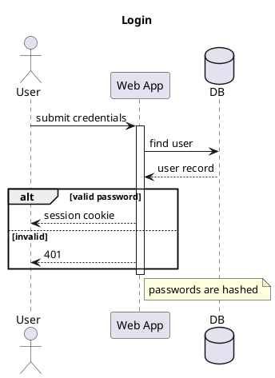
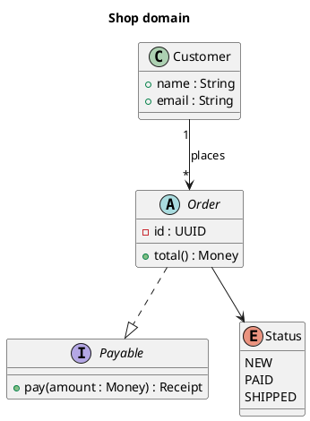
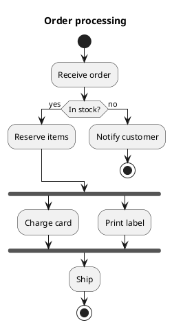
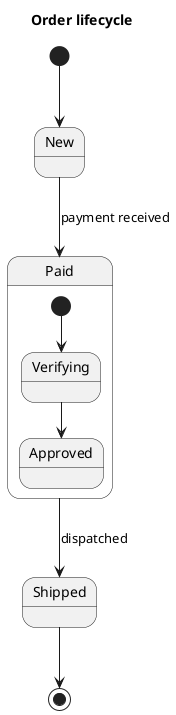
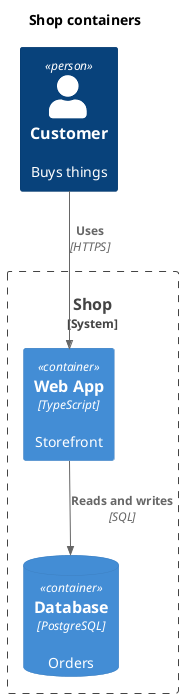
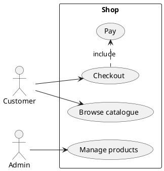
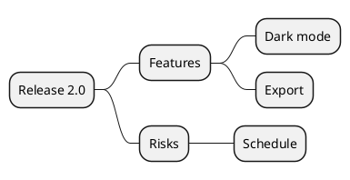
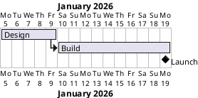
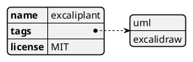
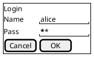

<!-- generated by scripts/skills.mjs from skills-src/ - do not edit -->

# PlantUML cheat sheet

Compact starting points for the most common diagram types. Every snippet on this page renders without warnings. For every other type see [diagram-types.md](diagram-types.md) and the files in `assets/examples/`.

Shared by all `@startuml` diagrams: `title`, `header`, `footer`, `legend … end legend`, `note left of X : text`, `skinparam name value`, colours as `#lightblue` or `#back:lightblue;line:blue`, comments with `'`, line breaks in labels with `\n`, `left to right direction`, `hide empty members`.

## Sequence

Arrows: `->` call, `-->` return/dashed, `->>` async, `-\` half arrow, `->x` lost. Fragments: `alt/else`, `opt`, `loop`, `par`, `critical`, `group`, all closed by `end`. Other keywords: `autonumber`, `==section==`, `...delay...`, `box "Name" … end box`, `create`, `destroy`, `return`.

## Class

Relations: `<|--` inheritance, `*--` composition, `o--` aggregation, `-->` association, `..>` dependency, `..|>` realisation. Members: `+` public, `-` private, `#` protected, `{static}`, `{abstract}`. Group with `package Name { … }`.

## Activity (new syntax)

Also: `while (cond?) … endwhile`, `repeat … repeat while (cond?)`, `switch (x) case (a) … endswitch`, `partition Name { … }`, swimlanes with `|Lane name|`, notes with `note right: text`.

## State

## Component and C4

Plain components: `component "API" as api`, `interface Port`, `database "DB"`, `[Component]`, `api --> db : SQL`. Deployment diagrams use `node`, `cloud`, `artifact`, `queue`, `storage`.

## Use case

## Mind map and WBS

`@startwbs` uses the same `*` outline syntax and draws an org chart.

## Gantt

## JSON and YAML

`@startyaml` takes YAML text the same way.

## Salt wireframe

## Processing notes

- Text outside `@start…@end` is ignored; a bare `A -> B` without any block is treated as a sequence diagram.
- Several blocks in one file: `--all`, or `--page n` for `newpage` documents.
- Variables and macros: `!$name = "value"`, `!define NAME value`, `!procedure $box($label)` … `!endprocedure`, `!if`, `!while`.
