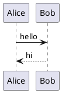

# Excaliplant for Obsidian

Renders PlantUML code blocks in your notes as hand-drawn, Excalidraw-style
diagrams. Everything happens inside Obsidian: no network access, no telemetry,
no external services, no account.

````markdown

````

Works in Reading view and Live Preview, on desktop and mobile. The fence
languages `plantuml`, `puml` and `uml` are recognised. `@startuml` / `@enduml`
may be left out.

## Per-block options

Put options after the language, in braces:

````markdown
```plantuml {theme=blueprint clean width=600 alt="Login flow"}
Alice -> Bob : hello
```
````

| Option         | Meaning                                                   |
| -------------- | --------------------------------------------------------- |
| `theme=<name>` | `sketch`, `plain`, `hachure`, `mono`, `dark`, `blueprint` |
| `clean`        | straight lines instead of the hand-drawn look             |
| `seed=<value>` | seed for stroke wobble                                    |
| `width=<px>`   | scale the diagram to this width                           |
| `alt="<text>"` | accessible text                                           |

## Settings

Theme (automatic follows light/dark mode), clean strokes, seed, maximum width,
transparent background and whether to list warnings.

## Commands

Place the cursor in a PlantUML block, then run one of these from the command
palette:

- Export diagram as .excalidraw attachment
- Export diagram as SVG attachment
- Export diagram as PNG attachment
- Copy diagram as Excalidraw JSON

Attachments are saved where your attachment settings say.

## Privacy and limits

- Network use: none. Telemetry: none. Files outside the vault: not accessed.
- `!include` is not supported (a note never reads other files); `!define`,
  variables, procedures and loops work.
- Diagrams are bounded (size, element count) to keep Obsidian responsive; an
  oversized diagram shows an error instead of freezing the app.
- Supported diagram types and PlantUML syntax are those of the excaliplant
  project; see its documentation.

## Source and license

MIT licensed. The plugin is built from
[grethel-labs/excaliplant](https://github.com/grethel-labs/excaliplant)
(`integrations/obsidian`); this repository only carries the release files.
Report problems at
[github.com/grethel-labs/excaliplant/issues](https://github.com/grethel-labs/excaliplant/issues).
See `THIRD_PARTY_NOTICES.md` for bundled components.
