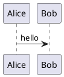

# Excaliplant: PlantUML as Excalidraw

Draw PlantUML as hand-drawn diagrams in VS Code. No Java, no Graphviz, no server:
the renderer is bundled with the extension and runs locally. The extension makes
no network requests and sends no telemetry.

<!-- Screenshots are added with the first release. -->

## Features

### Markdown preview

`plantuml`, `puml` and `uml` code blocks are drawn in VS Code's built-in Markdown
preview.

````markdown

````

The preview fills in diagrams as soon as they are rendered, and the extension
renders them in the background while you type, so the preview is complete quickly.
Attributes on the fence (`theme`, `clean`, `seed`, `width`, `alt`) override the
settings for one block.

Notebook Markdown cells are not supported: they render in a separate webview that
cannot load extension-host plugins.

### PlantUML files

Files ending in `.puml`, `.plantuml`, `.pu` or `.iuml` get the language mode
_PlantUML_ with basic syntax highlighting. If you also use another PlantUML
extension, both work side by side; pick the grammar you prefer with **Change
Language Mode**, or map files yourself with `files.associations`. This extension
does not override anything.

| Command                                         | What it does                                                                                                |
| ----------------------------------------------- | ----------------------------------------------------------------------------------------------------------- |
| **Excaliplant: Show Diagram Preview** / **Show PlantUML Source** | Switch between the same file's live preview and source in the current editor group. Unsaved edits appear in the preview and stay in the source editor. |
| **Excaliplant: Open Preview to the Side**       | Live preview of the file in a side panel (also in the editor title bar and the Explorer context menu).     |
| **Excaliplant: Render to Excalidraw**           | Writes an `.excalidraw` file you can open and edit in Excalidraw. Works on a `.puml` file or a Markdown block. |
| **Excaliplant: Render to SVG**                  | Writes a standalone SVG with the font embedded.                                                             |
| **Excaliplant: Replace diagrams in Markdown with SVG files** | Writes `assets/<hash>.svg` next to the Markdown file and replaces each block with an image link. The PlantUML source stays in a comment, so the diagrams can be rendered again. Undo restores the text. This is the route for GitHub, which does not draw PlantUML itself. |

When a file contains several diagrams, the one under the cursor is used;
otherwise you are asked which one.

PNG export is not offered: it needs the native `resvg` module, which cannot be
shipped in a platform-independent extension. Use **Render to SVG**, or the
`excaliplant` command line tool (`npx @grethel-labs/excaliplant diagram.puml -o diagram.png`).

## Settings

| Setting                         | Default  | Meaning                                                                                       |
| ------------------------------- | -------- | --------------------------------------------------------------------------------------------- |
| `excaliplant.theme`             | `auto`   | `sketch`, `plain`, `hachure`, `mono`, `dark`, `blueprint`, or `auto` (follows the VS Code theme). |
| `excaliplant.clean`             | `false`  | Clean strokes instead of the hand-drawn look.                                                 |
| `excaliplant.markdown.enabled`  | `true`   | Render diagrams in the Markdown preview (reload the window after changing it).                |
| `excaliplant.markdown.assetsDir`| `assets` | Folder for the SVG files written by _Replace diagrams in Markdown_; must stay inside the workspace. |
| `excaliplant.includeDir`        | empty    | Allow `!include` of files below this folder. Empty disables `!include`.                       |
| `excaliplant.limits`            | `{}`     | Overrides for render limits, for example `{ "maxElements": 50000 }`.                          |

## Security and Workspace Trust

Diagrams come from files you open, so they are treated as untrusted input.

- The renderer enforces size and complexity limits and never touches the network.
- SVG is rebuilt from an allow-list: no scripts, event handlers, external images or
  `foreignObject`.
- The PlantUML previews use webviews without scripts, with a Content Security Policy that
  only allows `data:` images, and without access to any local folder.
- `!include` is off by default. `excaliplant.includeDir` enables it for one folder
  (symbolic links that leave the folder are refused), and only in trusted workspaces:
  in a restricted workspace the include and limit settings of the workspace are ignored.

## Licence

MIT. The hand-drawn font (Excalifont) is licensed under the SIL Open Font
License 1.1; see `LICENSE-Excalifont.txt` and `THIRD_PARTY_NOTICES.md`.

Source, issues and documentation: <https://github.com/grethel-labs/excaliplant>
